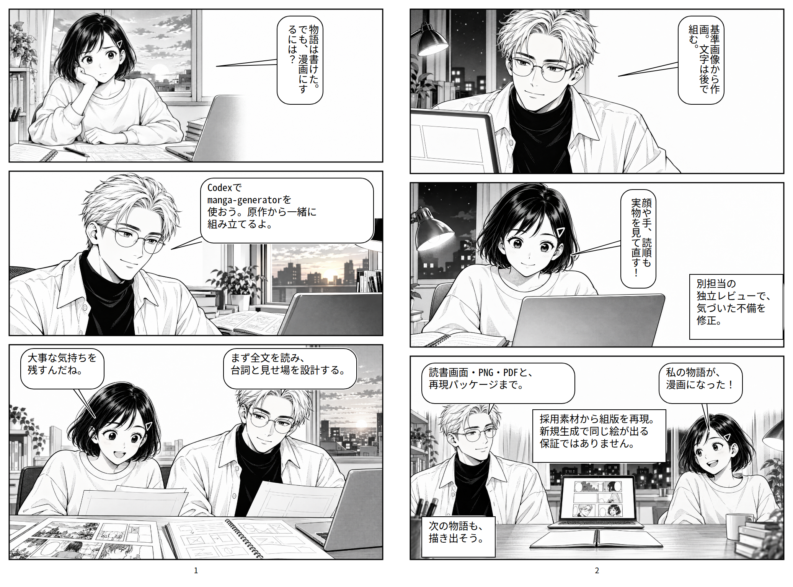

<h1 align="center">manga-generator</h1>

<p align="center">
  
  
  
</p>




原作の文章から、脚本・ネーム・画像生成・文字入れ・検品・PDF・再現パッケージまで制作する、Codex用のAgent Skillです。

[stockedge/manga-generator](https://github.com/stockedge/manga-generator) を基に、制作手順と実行処理を持ち運べるSkillへ再構成しています。

## インストール

配布された `manga-generator` フォルダーを丸ごと、利用中のCodexのSkill配置先（例: `~/.codex/skills/manga-generator/`）へ置いてください。Skill名と呼び出し名は `manga-generator` です。

```text
$manga-generator この原作を最後まで漫画化してください。
```

UTF-8の原作ファイルを添付するか、本文を貼り付けます。Skillが自動検出されない場合は、このフォルダーの [SKILL.md](manga-generator/SKILL.md) をCodexへ指定して、同じ制作を依頼してください。既存作品の修正・途中からの再開にも対応します。

制作に必要なものは次のとおりです。確認と導入はCodexが行うため、ユーザーは手順を覚える必要がありません。

- Node.js 24（制作CLIの実行。npm installは不要）
- Python 3（PDF出力用の依存をSkill内の共通venvへ導入）
- Chrome または Edge、日本語フォント、Poppler（組版とPDFの検品）
- Codex側の機能：画像生成、生成画像の視覚確認、独立サブエージェントレビュー

環境準備や制作コマンドはCodexが実行します。必要なソフトとvenv作成は [環境準備](manga-generator/references/environment.md) にまとめています。ツールや利用枠が不足した場合は、途中状態を保存して未完成の工程を報告します。

## 作品の保存と配布

Skill本体と作品の保存場所は分かれています。`production/` や `works/auto-***` を挟まず、指定したフォルダーがそのまま1作品になります。制作の途中も完成後も、作品データはすべてSkillの外に用意した**制作フォルダー**へ保存されます。共通環境だけはSkill内 `.runtime/` へ初回準備し、各作品で再利用します。Skillを更新しても制作途中の作品はそのまま再開できます。

```text
<作品フォルダー>/              # 例: skill-introduction/。1フォルダ＝1作品
├── workflow.json             # 脚本・登場人物・台詞の配置設定
├── source/original.txt       # 原作
├── assets/                   # 基準画像・生成候補・採用素材
├── workflow/                 # ネーム・生成記録・正式レビュー
│   └── scripts/              # この作品専用の補助スクリプト
├── scratch/                  # 一時JSON・レビュー用入力
├── output/                   # PNG・SVG・reader.html・PDF・編集用レイヤー
├── releases/                 # 確定済み再現パッケージ
└── .manga-history/           # 途中状態の保存・復元
```

- 台詞の修正はworkflow.jsonを直して再組版でき、絵の再生成は不要です。
- 完成作品を配布するときは、`releases/` に保存されたパッケージ1つを渡します。相手は展開するだけで完成漫画・読書画面を閲覧でき、当時の実行コードも同梱されているため再現検証が可能です。
- このSkillを別の人へ渡すときは `setup.mjs bundle` で作ったコピーを使います。実行処理・手順・公開サンプルは含みますが、個人作品・制作履歴・venv・環境バージョン記録は含めません。

## 内容

| 場所 | 内容 |
| --- | --- |
| [SKILL.md](manga-generator/SKILL.md) | Codex向けの制作指示 |
| [references/environment.md](manga-generator/references/environment.md) | 必要環境・venv・依存の確認 |
| scripts/ | 共有エンジンの起動・保存先作成・再配布・環境記録 |
| engine/ | 組版・画像採用・履歴・検品・PDF・再現検証の実行処理 |
| [engine/REPRODUCE.md](manga-generator/engine/REPRODUCE.md) | 制作CLIの詳しい手順 |

## 原作ツールへの謝辞

本Skillは、原作ツール **[Manga Generator](https://github.com/stockedge/manga-generator)** の実装と制作ノウハウを基盤としています。脚本から作画・組版・検品・履歴保存・再現検証へつなぐ仕組みを公開してくださった原作者と貢献者の皆さまに感謝します。

- 原作リポジトリ：[stockedge/manga-generator](https://github.com/stockedge/manga-generator)
- リポジトリ公開者：[stockedge](https://github.com/stockedge)
- 原典の著作権表記：Copyright (c) 2026 issei.mori
- 原典のライセンス：[MIT License](https://github.com/stockedge/manga-generator/blob/master/LICENSE)

この配布物は、元リポジトリをCodex用Skillとして再構成し、環境準備・独立した制作フォルダー・再配布の案内を追加したものです。

## ライセンス

ソースコードとドキュメントは [MIT License](LICENSE) で提供し、原典の著作権表示とライセンス全文を保持しています。利用者が用意する原作や参照素材、外部モデル、生成物には、それぞれの権利と利用条件が適用されます。
